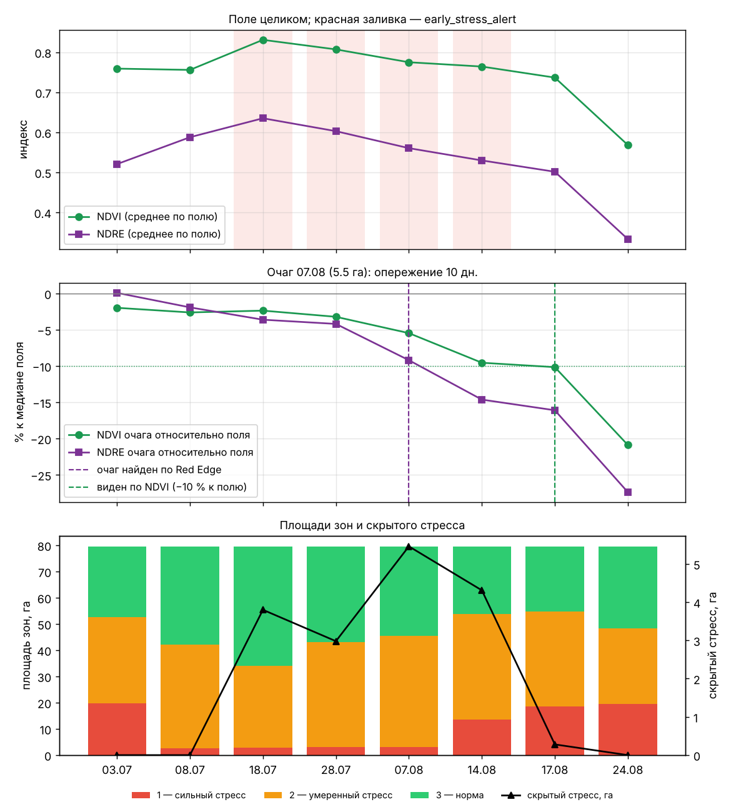
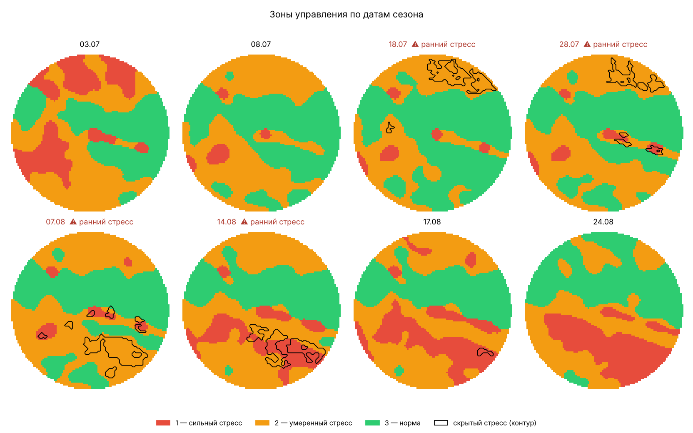
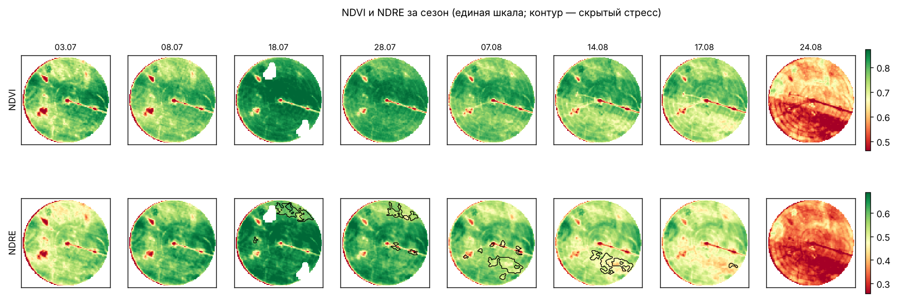

# Модуль 2: сезон 2026 — зоны, скрытый стресс и калибровка (КТ4)

Данные: серия M1 `data/scenes/`, 8 дат с 3 июля по 24 августа 2026, поле T37TEN (79,6 га, 7960 px).
Результаты получены так (из `src/module2`):

```bash
python -m stress_core update ../../data/scenes -o ../../data   # зоны, индексы, статистика по датам
python -m stress_core check ../../data                         # контракт с M3/M4
python -m stress_core season ../../data                        # картинки и season_report.json
```

## Главное

- **Ранняя детекция по Red Edge видна.** Очаг на юге поля (5,5 га) отмечен скрытым стрессом 7 августа:
  NDRE там уже на 9 % ниже медианы поля, NDVI — только на 5 %. Ниже поля на 10 % по NDVI он уходит
  17 августа, на 21 % — 24 августа, когда юг становится зоной сильного стресса.
  **Опережение — 10 дней** до заметного падения NDVI и 17 дней до обвала.
- **Тревоги `early_stress_alert`:** 18 и 28 июля (пятно на северо-востоке), 7 и 14 августа (юг).
- **Площадь поля в масках зон — 79,6 га на всех датах.** На 18 июля облако и тень (4,12 га, 5,18 % поля)
  заполнены классом ближайшей зоны; проверка стабильности площади в M3 проходит (`check`: OK).



Верхний график — средние по полю (созревание с середины августа). Средний — очаг 7 августа относительно
поля: NDRE (фиолетовая) уходит вниз раньше NDVI (зелёная). Нижний — площади зон и скрытого стресса.





## Что изменено по итогам сезона

Старое временное правило (резкое падение z-аномалии NDRE) подбиралось на синтетике с внезапным очагом и
на реальной серии почти не срабатывало: здесь спад постепенный и захватывает широкий участок, а z-аномалии
между соседними датами меняются мало (в августе 1-й перцентиль изменения −0,6…−0,8 при пороге −1,0).

Добавлено правило **`decline`**: в пикселе NDRE за интервал действительно упал, причём на 4 п.п. и больше
сильнее медианы поля, и это сверх-падение в 1,5 раза больше, чем у NDVI (то же соотношение 1,5, что и в
правиле тревоги). Медиана поля вычитается, поэтому общее созревание, дымка и сдвиги калибровки не дают
срабатываний.

**Как проверялось.** Для каждой даты отмеченные пиксели сравнивались с худшей четвертью поля по дальнейшему
падению NDVI к 24 августа. Случайный выбор попадал бы туда в 25 % случаев.

| Дата | spatial, га | temporal, га | decline, га | decline в худшей четверти по будущему падению NDVI |
|---|---|---|---|---|
| 03.07 | 0 | — | — | — |
| 08.07 | 0 | 0 | 0 | — |
| 18.07 | 3,39 | 0,77 | 0 | — |
| 28.07 | 2,14 | 0 | 1,01 | 2 % (ложное) |
| 07.08 | 0,11 | 0 | 5,44 | 83 % |
| 14.08 | 0 | 0 | 4,31 | 95 % |
| 17.08 | 0 | 0 | 0,28 | 100 % |

Порог перебирался в диапазоне 0,02–0,05: при 0,04 и выше точность в августе 81–97 %, при 0,02 — 70–76 %
и в 10 раз больше ложных отметок 28 июля. Без условия «NDRE в пикселе действительно упал» правило давало ложные 6 га
8 июля (в фазе роста отмечались участки, где NDRE просто рос медленнее поля), с условием — 0.

## Ограничения

- Одно поле и один сезон, полевой разметки нет: правило показывает, где посев сдаёт раньше остального поля,
  но не различает болезнь, засуху и неравномерное созревание. По кривой NDVI культура — яровая пропашная
  (гипотеза M1), и августовский спад — созревание, на юге — более раннее и сильное.
- Пятно на северо-востоке 18–28 июля (правило `spatial`): по разбору M1 это скорее другая фаза развития
  посева (другой срок посева сектора), после 14 августа разница исчезает. Отметки 28 июля вдоль колеи
  дождевальной машины — постоянный объект, не стресс.
- Зоны относительные: класс 1 — «хуже остального поля на эту дату». В начале июля, когда поле ровное,
  класс 1 занимает до 20 га, хотя стресса нет.
- На другом поле или культуре пороги нужно проверять заново: `python -m stress_core season data` строит
  те же графики для любой серии.
